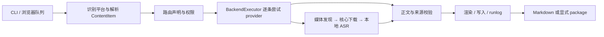

# Openmd 架构与接手入口

**一个链接 → 原始正文或逐字稿 → 校验后的 Markdown**。默认不总结、不改写；
文章、字幕、ASR、OCR 的来源和完整程度分别报告。先读此页，再按职责进入源码。

## 模块职责

| 入口 | 所有权与边界 |
|---|---|
| `cli.py` / `__main__.py` | 命令分派与兼容导入；保留既有调用和测试替换入口 |
| `cli_parser.py` / `cli_commands.py` | 参数与各单项命令；不定义第二条提取流水线 |
| `cli_items.py` | identity → skip → extract → validate → write → log，顺序保持不变 |
| `cli_collections.py` / `cli_receipts.py` | 合集发现、coverage、compact 回执、恢复；发现清单不等于提取全文 |
| `interactive.py` / `browser_host.py` | 日常输入、保存交互 / 浏览器串行队列；共同消费核心 CLI 服务 |
| `core/detector.py` / `adapters/registry.py` | 识别输入，解析 `ContentItem`；平台 adapter 负责解析，runtime provider 负责网络提取 |
| `routing/declarations.json` / `routing/loader.py` | bundled 路由、卡片、能力、合集默认声明的唯一源 / 校验与有效投影；本机 overlay 只调整用户配置 |
| `backends/registry.py` / `backends/executor.py` | 按 gates 构造 provider、执行 fallback；每次失败留证据，内容结论优先于工具缺失 |
| `runtime/media.py` / `runtime/asr.py` / `runtime/tingwu.py` / `ocr/` | 临时媒体下载、本机模型工作进程、显式授权的听悟音频后端、OCR；不自动下载模型，不自动开启云服务 |
| `core/content_validation.py` | 拒收错误页、空壳、元数据冒充正文；合法引用必须有近邻正例 |
| `core/renderer.py` / `output.py` / `package_writer.py` / `runlog.py` | 统一原文渲染、落盘与身份/恢复记录；`--package` 才输出结构化包 |

`TranscriptResult` 同时承载文章、文档、字幕和 OCR，是历史兼容名称。
`status`、`source_level`、合集 source-exhausted 和组件覆盖是不同维度。
CLI 的兼容 facade 仍保留共享依赖；本次职责拆分不宣称完成依赖反转。

## 在哪里加平台

已有工具优先在 `routing/declarations.json` 增加卡片/路由，再运行
`python -m openmd.routing.generate`；生成的 routes/cards/docs 不独立手改。
需要平台解析/API 时在 `adapters/<platform>` / `backends/<platform>` 增加实现，
保持 discovery 与 extraction 分离。具体字段、证据和模板见
[接入指南](adding-a-platform.md)，故障与测试入口见[子系统地图](subsystems/README.md)。

独立平台包用 `openmd.platforms` entry point 返回 `PlatformPlugin`：明确声明
平台识别、adapter/backend 模块、collection binding 和资源。插件使用自己的
namespace；重复 ID、缺资源或缺 registrar 失败，不猜核心模块。未安装插件时
核心行为保持独立；插件发现本身不授予网络、浏览器、下载、ASR 或 cloud 权限。

## 从读懂到验证

先运行受影响测试，再按 [CONTRIBUTING](../CONTRIBUTING.md) 完整回归。
[预防检查](prevention-checks.md) 覆盖安装后的 wheel、声明漂移、进程时序、
正反例内容、外部协议与运行证据。真实可用性仍须授权链接跑真实 CLI 并读产物。

## 四层边界：来源兜底、引擎、裁判与同步

Openmd 把“拿到什么”“怎么拿”“能不能信”“是否覆盖用户文件”分开记录。四层共享同一份结果上下文，但各自有独立的失败边界：

| 层 | 负责什么 | 不能推出什么 |
|---|---|---|
| 三块来源兜底 | 原生网页/平台文本；浏览器与托管 OpenCLI；媒体下载后本机 ASR/OCR | 某个来源可达不等于正文已完整取得 |
| 引擎层 | adapter/provider、文档引擎、浏览器队列、媒体与模型工作进程，按声明的路线取得候选正文 | 进程退出 0 不等于正文有效 |
| 裁判层 | 内容校验、错误页/登录墙拒收、`status`、`source_level`、`completeness` 与 `fallback_attempts` | `verified` 不表示来源永远不会变化 |
| 同步层 | canonical 文件的创建、未变化、冲突保留和缺失恢复；保留用户手改并记录更新回执 | 一次成功提取不授权覆盖用户编辑 |

来源层只提供候选材料；引擎层只负责取得候选材料；裁判层决定候选材料能否作为正文保存；同步层决定如何把已裁判的正文写入目标目录。Agent 应优先读取 JSON 回执和实际产物，再根据 `next_action` 继续。
